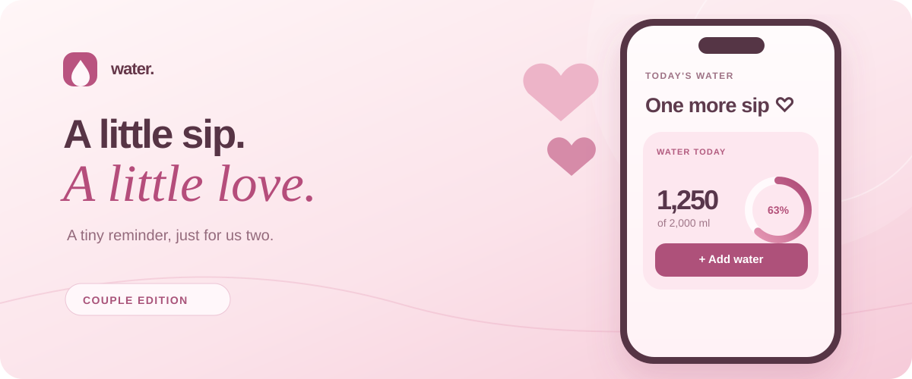

<p align="center">
  
</p>

<div align="center">

# Water ♡

**Một chút nước, một chút thương.**  
*A little sip, a little love.*

A tiny hydration tracker for two iPhones. Soft pink, Vietnamese / English, no ads or account.

[**Open the app**](https://hungdeniubeo.github.io/water-reminder-ios/) · [Install on iPhone](#install-on-iphone) · [Enable notifications](./docs/SETUP_PUSH.md)

</div>

---

## What's inside

- **Today:** one-tap 150 / 250 / 500 ml, custom water amounts, daily progress and drink history.
- **History:** 7-day chart, recent daily totals, quick goal overview.
- **Us two:** personal names, a message for your partner, optional private pairing and today's shared totals.
- **Gentle nudges:** in-app reminders today; real iPhone Web Push when the Cloudflare Worker is configured and each device opts in.
- **VI / EN:** switch at the top of the app; preference is saved on that iPhone.
- **Privacy first:** water entry details stay on the device. JSON export/restore is available in Settings.

## Install on iPhone

1. Open **https://hungdeniubeo.github.io/water-reminder-ios/** in **Safari** on iPhone.
2. Tap **Share → Add to Home Screen → Add**.
3. Open **Water ♡** from the Home Screen. No App Store, Xcode, or Apple Developer membership required.

GitHub Pages must be enabled at **Settings → Pages → Deploy from a branch → main / (root)**. The PWA works offline after the initial load and service worker installation.

## A note about notifications

**GitHub Pages cannot send lock-screen notifications by itself.** The frontend supports Web Push, but until the private Cloudflare Worker / D1 sender is deployed, the app **only displays in-app reminders while it is open**. We deliberately show that limitation in the interface.

The backend source is in [`backend/`](./backend). Setup for just two phones is in **[docs/SETUP_PUSH.md](./docs/SETUP_PUSH.md)**.

Once connected, the sender uses the recipient's selected language and the partner's custom note. iOS 16.4+ supports Web Push for Home Screen web apps; delivery still depends on device permission, network and Focus mode.

## Local development

```bash
python3 -m http.server 8000
```

Visit `http://localhost:8000`. The frontend needs no bundler. To run the tests with Node.js 22+:

```bash
npm test
```

### Files

| Path | Purpose |
|---|---|
| `index.html`, `styles.css` | App UI, pink theme, responsive layouts |
| `app.js`, `logic.js`, `i18n.js` | Water logging, date logic, VI / EN |
| `couple.js`, `push-config.js` | Optional backend connection and pairing |
| `sw.js`, `manifest.webmanifest` | Offline experience, install, push handling |
| `backend/` | Cloudflare Worker, D1 schema and VAPID sender |
| `docs/SETUP_PUSH.md` | One-time backend setup |

## Privacy

No analytics, ads, or account sign-in. Every drink entry stays in the browser's local storage on its iPhone. If optional couple pairing is enabled, the server stores minimal push and couple metadata and **daily totals only**, not an entry-by-entry drinking history. Read [PRIVACY.md](./PRIVACY.md).

<sub>Personal project. No open-source license has been added.</sub>