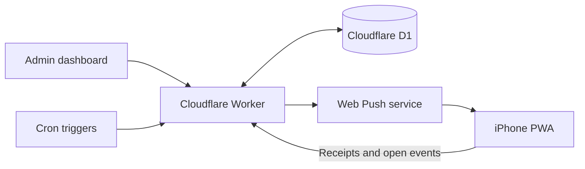

# Beo Daily

A private daily reminder app for one iPhone, with a mobile-first admin dashboard and scheduled Web Push notifications.


[Open app](https://hungdeniubeo.github.io/water-reminder-ios/) · [Admin dashboard](https://hungdeniubeo.github.io/water-reminder-ios/admin.html) · [Setup guide](docs/ADMIN_SETUP.md)

## Overview

Beo Daily provides a simple way to manage personal reminders remotely and deliver them to a paired iPhone. Originally built for hydration reminders, it now supports everyday routines, custom messages and scheduled events.

The recipient uses an installable web app, while the administrator manages schedules, messages and device connections from a separate dashboard. No native iOS build is required.

## Features

| Feature | Description |
| --- | --- |
| Flexible schedules | Fixed times, repeating intervals, randomized daily times and date-specific reminders. |
| Custom messages | Fixed notification content or up to 10 message variations per schedule. |
| Quick templates | Prefill reminders for work, lunch, rest and bedtime without automatically saving them. |
| Instant notifications | Compose, preview and send a message directly to the paired iPhone. |
| Upcoming reminders | Preview the next three scheduled times in the configured time zone. |
| Device management | Pair, replace or disconnect the recipient's iPhone using a separate admin session. |
| Delivery history | Track push acceptance, device receipts and notification opens when reported. |
| System management | Monitor D1 storage, configure history retention, export records and clean up expired entries. |

### iPhone experience

- Installable Progressive Web App (PWA) with Home Screen access.
- Daily greeting, personal notes and the latest received message.
- Web Push notifications without keeping the app open.
- A lightweight interface designed for a single recipient.

### Admin experience

- Mobile-first dashboard with bottom navigation and bottom-sheet forms.
- Two-column desktop layout with drawer-based editing.
- Independent controls for each reminder schedule.
- Live notification preview and delivery tracking while the dashboard is open.

## Architecture



| Layer | Technology |
| --- | --- |
| Frontend | HTML, CSS, JavaScript, GitHub Pages |
| Mobile app | PWA, Web App Manifest, Service Worker |
| API and scheduling | Cloudflare Workers, Cron Triggers |
| Storage | Cloudflare D1 |
| Notifications | Web Push with VAPID |

## Connect an iPhone

Requires iOS 16.4 or later.

1. Sign in to the admin dashboard and generate a pairing code.
2. Open the recipient app in Safari on the target iPhone.
3. Select **Share → Add to Home Screen**.
4. Launch the installed app and enter the pairing code.
5. Enable notifications and grant permission.
6. Send a test message from the dashboard and verify it on the iPhone.

Pairing codes are separate from administrator credentials. Keep the existing installed PWA and device connection when updating the app.

## Development

Requires Node.js 22.18 or later.

```bash
git clone https://github.com/hungdeniubeo/water-reminder-ios.git
cd water-reminder-ios
npm ci --prefix backend
npm run check
npm test
```

The test suite covers scheduling, time zones, device pairing, notification states and frontend behavior. Actual notification delivery must be verified on a physical iPhone.

## Deployment

The frontend is hosted on GitHub Pages from the `main` branch. The Worker and D1 database are deployed separately.

For an existing configured Cloudflare environment, apply any outstanding migrations before deploying the Worker:

```bash
cd backend
npm ci
npm run db:routines
npm run db:reminders
npm run db:system
npm run deploy
```

For initial configuration, credentials and earlier database migrations, follow the setup guides below. Do not replace existing VAPID keys or device credentials during routine updates.

## Scheduling and delivery

- All schedules use their saved time zone. Randomized daily times are deterministic for each schedule and day, with at least 15 minutes between generated times.
- Invalid calendar dates are skipped. Delayed cron runs catch up only the most recent eligible occurrence within 14 minutes.
- Message variations rotate to reduce repetition during the day.
- Upcoming times and notification previews are estimates or simulations, not delivery confirmations.
- Push service acceptance does not guarantee that a notification appeared on the iPhone. Device receipts and open events are tracked separately.
- History retention supports 30, 60 or 90 days. Cleanup removes expired notification history, not schedules or paired devices. JSON export includes up to 5,000 recent records; manual cleanup handles up to 1,000 expired records per run.

## Documentation

| Guide | Purpose |
| --- | --- |
| [Admin setup](docs/ADMIN_SETUP.md) | Administrator access, device pairing and troubleshooting |
| [Push setup](docs/SETUP_PUSH.md) | Web Push and Cloudflare configuration |
| [Reminder plan](docs/REMINDERS_PLAN.md) | Reminder scheduling design |
| [Privacy](PRIVACY.md) | Data handling and privacy information |

---

Designed for personal use with one administrator and one recipient.
