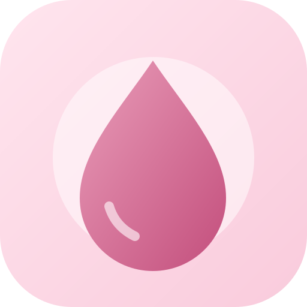

  

  <h1>Beo Daily</h1>

  
A personal reminder app for everyday routines.

  
  
  

  

    <a href="https://hungdeniubeo.github.io/water-reminder-ios/"><strong>Open app</strong></a> ·
    <a href="https://hungdeniubeo.github.io/water-reminder-ios/admin.html">Admin dashboard</a>
  

## About

Beo Daily is a personal project designed to send daily reminders and messages to a paired iPhone. Originally built for hydration reminders, it now supports everyday routines such as meals, work, rest and bedtime.

The app runs as a Progressive Web App (PWA), with a separate admin dashboard for managing reminders remotely.

## Key features

- **Smart scheduling** — Fixed times, recurring intervals, randomized reminders and specific dates.
- **Personal messages** — Custom notification content and rotating message variations.
- **Instant reminders** — Send a notification directly from the admin dashboard.
- **Notification history** — Track delivery status and device receipts.
- **iPhone integration** — Home Screen access and Web Push notifications.
- **Private by design** — Dedicated access for one administrator and one recipient.

## Technology

| Component | Technology |
| --- | --- |
| Frontend | HTML, CSS, JavaScript |
| Application | Progressive Web App |
| Hosting | GitHub Pages |
| Backend | Cloudflare Workers |
| Database | Cloudflare D1 |
| Notifications | Web Push |
| Automated testing | GitHub Actions |

## Project

[Commit history](https://github.com/hungdeniubeo/water-reminder-ios/commits/main/) · [Issues](https://github.com/hungdeniubeo/water-reminder-ios/issues) · [Privacy](PRIVACY.md)

Developed by [hungdeniubeo](https://github.com/hungdeniubeo).
